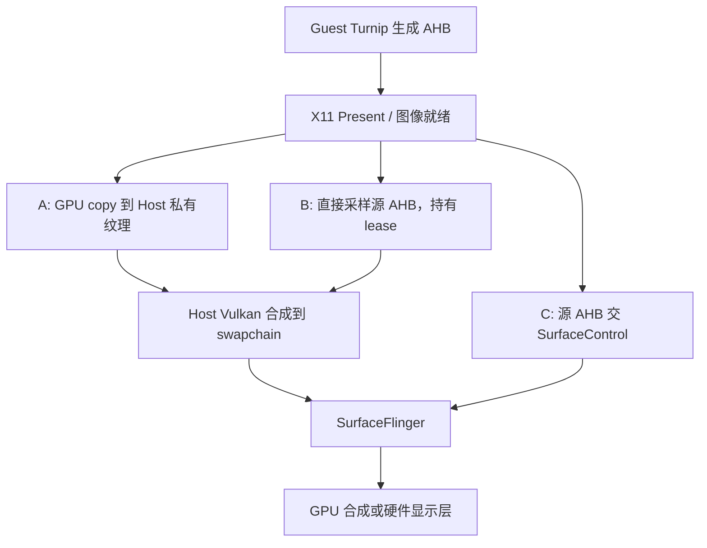
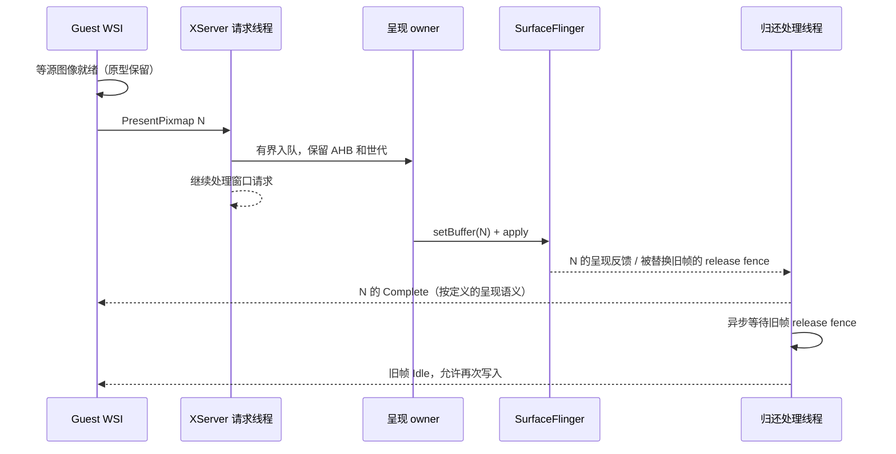

# SteamPSP AHB 减拷贝与 scanout：实施前评估 v1

日期：2026-10-13。状态：**DRAFT / 待独立评审，未实施，未进行本轮设备性能对照**。

本文供另一个 AI 或工程师判断是否值得实施。内容分为已核实的源码事实、历史实验和拟议方案；后两者不能当成本轮已完成工作。目标是普通平面模式 AI LIMIT，先评估减少显示链路的拷贝与串行等待；不迁移到 DroidDeck、Linux Steam、gamescope 或 Wayland，不扩大为 SBS/Swan/PCVR 改造。

## 1. 给评审者的结论与问题

**当前 VulkanRenderer 内的 scanout 不是打开一个开关即可使用；AHB 直接采样已有实验入口，但仍有同步等待。** 另有已接通的 `surfaceflinger` / ASurfaceRenderer，可复用其部分显示回收实现，但也需补齐 Guest 源 buffer 的归还合同。建议先批准有界的路径计量和正确性探针，再在“异步直接采样”和“SurfaceControl 直呈”之间选择实现。现有证据不足以承诺 FPS 收益。

请重点回答：

1. 下文对两种 renderer 的入口、buffer 所有权、fence 与 X11 Complete/Idle 的判断是否准确？有无遗漏的调用方？
2. AI LIMIT 已有“提前渲染”优化后，显示拷贝/合成是否仍处于关键路径？需要哪些最小测量才能判断？
3. 先做直接采样，还是直接补全 scanout，哪条路线更值得投入？允许给出“先测量、暂缓实现”的结论。
4. 现有 Turnip AHB 分配/同步能否作为原型基线？是否必须改 WSI？如何证明消费者结束读取后游戏才能复用？
5. 对性能对照、回退和生命周期门槛有何删减或补充？请区分阻断项与可后置项，并列出涉及文件。

评审可直接使用本文第 3 节的索引复查。不要把 DroidDeck 的零拷贝名称、GPU busy 未满、CPU fence elapsed 或历史 Hades 实验直接转换成预计提速。

## 2. 固定基线与历史证据

| 对象 | 本次审阅版本 |
|---|---|
| SteamPSP | `feature/malos/swan-xr-ahb`，`dc877ba12dfe3ad32138c38b3f8bf33e64e72142`；此次只增加/修改文档 |
| DroidDeck | `references/DroidDeck`，`2503d6929332de2a4a22c8a31c1b3ce84e5a8831`；[owned fork](https://github.com/tencentmalos/DroidDeck)、[上游固定版本](https://github.com/Droid-Deck/DroidDeck/tree/2503d6929332de2a4a22c8a31c1b3ce84e5a8831) |
| Turnip | `references/mesa-turnip`，`4815dc717db1cadf0e7ccf127a846a538b59891f`；当前 recipe 的 xrg13 基线，实际测试时仍须核对加载的制品 |
| 当前设备 | 本轮未连接设备。历史 AI LIMIT 是 AYN Thor；后续先核对实际连接设备，不能把 Thor 数字用于 Odin 3 或其他设备的跨机比较 |

历史结果来自 [AI LIMIT 呈现链实验](../validation/ai-limit-present-pipeline-20261002.md) 与 [等待链分析](../validation/ai-limit-sync-fastpath-20261002.md)：

- 原 async copy → copy 提交/回收分离 → 原路径：14.942 / 15.268 / 15.838 次 SurfaceFlinger 呈现每秒，**没有稳定收益**。
- 相应 `host.present.copy` CPU elapsed 从约 24 ms 变为 0.565 ms，是等待搬到约 22 ms 的 retire 阶段；不是 GPU 拷贝只需 0.565 ms，更不是节省了 23 ms GPU 工作。
- DXVK 改用 GPU 完成放行下一帧后，相近固定视角约 15.7 → 22.1–22.3 次呈现每秒，GPU busy 约 73% → 99.9%。视角、温度、频率及独立游戏帧识别有记录中的限制；**这一收益不能归给减拷贝，也不能再次算作本方案收益**。
- [较早 Hades 直接采样实验](../validation/personal-p3-debuggers-20260927.md#preliminary-same-scene-comparison) 未观察到帧率提升；不同进程、受刷新节奏约束的样本不足以证明 CPU/RSS 收益。它不等于 AI LIMIT 验收。

## 3. 当前代码复核

本节链接指向工作树，括号行号对应上述主仓基线；后续代码移动后以函数名查找。表格先审阅历史 AI LIMIT 使用的 VulkanRenderer 链路；独立 ASurfaceRenderer 见 §3.3，不能把前者的未接通误写成整个项目没有 SurfaceControl。新增文档不构成新的 runtime 版本。

| 已核实事实 | 代码位置 | 判断 |
|---|---|---|
| Turnip 已分配真正的 AHB，并用私有 DRI3 modifier `1255`/socketpair 传 handle | [wsi_common_x11_android.inc](../../references/mesa-turnip/src/vulkan/wsi/wsi_common_x11_android.inc)，`x11_android_create_mem` / `x11_android_image_attach` | 不必为了共享 AHB 先改成 Wayland；已有跨进程 buffer 通路 |
| 当前 usage 是 `GPU_SAMPLED_IMAGE | GPU_FRAMEBUFFER` | 同上，约 L21–28 | 能 GPU 导入不自动证明当前设备可硬件 overlay；实际格式、usage、stride、分配器 metadata 均需核验 |
| picoXr DRI3 收到 handle 后创建 GPU-only `GPUImage`，不先 CPU lock | [DRI3Extension](../../app/src/main/java/com/winlator/xserver/extensions/DRI3Extension.java)，L145/153；[GPUImage](../../app/src/main/java/com/winlator/renderer/GPUImage.java)，socket 构造函数 | 当前基线没有这一步的 CPU 读回；减的是 GPU 拷贝/合成 |
| picoXr 的 GPUImage Present 优先进入专用 copy/sample 分支并返回 | [PresentExtension](../../app/src/main/java/com/winlator/xserver/extensions/PresentExtension.java)，`presentPixmap`，约 L435–525 | 即便打开旧 nativeMode，也不会自动到后面的 generic `onUpdateWindowContentDirect` scanout 分支 |
| `nativeMode` 初始 false；`setNativeMode` 只有定义，当前 app Java/Kotlin 未找到调用 | [VulkanRenderer](../../app/src/main/java/com/winlator/renderer/VulkanRenderer.java)，L133/863 | 第一处接通阻断；还应检查今后的 JNI/反射入口，不能仅凭 UI 名称判断生效 |
| `Drawable.isDirectScanout()` 固定返回 false | [Drawable](../../app/src/main/java/com/winlator/xserver/Drawable.java)，L106 | 第二处接通阻断；不能全局改 true，需要逐窗口/逐帧 eligibility |
| scanout 实现确实被编译进 picoXr | [CMakeLists](../../app/src/picoXr/cpp/CMakeLists.txt)，L102–103；[JNI](../../app/src/main/cpp/winlator/vulkan_jni.cpp)，L238–304 | 不是漏打包；“有符号/有代码”不等于运行中使用 |
| 旧 scanout 调 `GPUImage.unlock()`、`setBuffer` 后再 `lock()` | [VulkanRenderer](../../app/src/main/java/com/winlator/renderer/VulkanRenderer.java)，L619–625 | GPU-only 对象通常没有 CPU mapping，`unlock()` 返回 -1，不能据此取得 Guest GPU 完成 fence；`lock()` 还会尝试 CPU 映射，不适合直接沿用 |
| scanout 本体只有提交和 AHB 引用操作，未接显示 release 回调到 Present Idle | [VulkanRendererScanout](../../app/src/main/cpp/winlator/VulkanRendererScanout.cpp)，`loadScanoutApi` / `scanoutSetBuffer`，L21/165 | 关键正确性阻断；AHB 引用计数保护对象存活，不能证明内容已不再被显示消费者读取 |
| 旧 scanout 几何按 container 宽高裁剪，`x/y` 不参与实际目标计算 | 同上，`scanoutSetBuffer` | 普通窗口、偏移、裁剪、旋转、缩放都不能默认为正确；首个原型限定单个全屏不透明窗口 |
| `XRGAME_AHB_PRESENT=sample` 是实际存在的 debug-only 入口 | [XServerScreen](../../app/src/main/java/app/gamenative/ui/screen/xserver/XServerScreen.kt)，L2036；[VulkanRenderer](../../app/src/main/java/com/winlator/renderer/VulkanRenderer.java)，L74–94 | 它省 AHB→私有纹理拷贝，仍执行 Host 合成，不是 SurfaceControl 直呈 |
| sample 替换前在 `frameMutex`、`renderMutex` 下提交 barrier 并同步等 fence | [VulkanRendererContext](../../app/src/main/cpp/winlator/VulkanRendererContext.cpp)，`submitAhbBarriers` L1929、`sampleWindowContentAHB` L1973、`retireSampledWindow` L2014 | 直接开已有 sample 可能把长等待重新带回 X 请求链，不能当成最终性能方案 |

### 3.1 已有模式的真实条件

**异步 GPU copy**：`XRGAME_PRESENT_ASYNC_COPY=1`；请求实际还须 `waitFence=0`、`idleFence=0`、Host limiter=0、offset=0，且 sample 不生效。`copy_pipeline` 默认关闭，需要 async copy 已激活；配置切换等待已接收任务排空。检查 `Requested` 和 `Active`，不能只看 UI 勾选。

**直接采样 sample**：debug + XRGAME、renderer 初始化完成、`!nativeMode`、`!frameGenArmed`、平面呈现开启且 `xrFrameBridge == null`；Present 还要求已映射窗口、offset=0、waitFence=0。native 侧另拒绝 surfaceDetached、scanout、XR target、重复/跨窗口 AHB。某些不支持的请求形态会回 copy，但已选中的 sample 若失败则报 BadAlloc，**不能把它称为已具备所有失败的无缝回退**。

[`HardwareBufferLeases`](../../app/src/main/java/com/winlator/renderer/HardwareBufferLeases.java) 保留每窗口当前 Present；替换/退休完成才发旧帧 Idle。其 Complete 目前表达 host 接受图像，并非测得实际显示；这是历史文档已有的边界。本方案必须分别评价“复制次数变化”和“Complete 语义变化”带来的效果。

**SurfaceControl scanout**：现有 native API 加载要求 Android API ≥29；还需要前述三处入口改造、合格 buffer/窗口、可靠的 producer-ready 证明、显示归还通知、异常回收和合成回退。`setNativeMode` 禁止 SBS 影院；首轮方案进一步明确排除所有 XR 路径、帧生成、HDR 和 shader 特效。不得通过全局 `isDirectScanout=true` 实现。

### 3.2 三条路径省掉的工作不同



这里只计算应用显示通路：A 有一次显式 `CmdCopyImage` 加 Host 合成；B 省显式拷贝但保留合成；C 可同时省这两步。游戏渲染内部、驱动和系统 compositor 的工作不在这个计数里。SurfaceControl 直呈也不保证物理硬件 scanout，需核验实际合成方式。

XServer 继续负责窗口/输入/Present 协议。减少像素搬运不需要先移除 XServer。

### 3.3 不能遗漏的现成 ASurfaceRenderer

[`XServerView`](../../app/src/main/java/com/winlator/widget/XServerView.java) L32–37 已按 `selectedRenderer=surfaceflinger` 创建 [`ASurfaceRenderer`](../../app/src/main/java/com/winlator/renderer/ASurfaceRenderer.java)，并令 DRI3 使用 [`AHBImage`](../../app/src/main/java/com/winlator/renderer/AHBImage.java) 收 buffer。这个入口与 `VulkanRenderer.setNativeMode` 是两回事。

[`ASurfaceRendererContext::setWindowBuffer`](../../app/src/main/cpp/asurfacerenderer/ASurfaceRendererContext.cpp)（L324 起）有两条路径：

- `sfCompatMode=true`：经 BlitConverter 转到自有 AHB pool，再提交 SurfaceControl。已有 `transactionCompleteCallback` + `getPreviousReleaseFenceFd`，用于转换目标 pool 的复用/销毁。这是可以优先审阅复用的代码，但仍有 GPU 转换，不是源 AHB 零拷贝。
- `sfCompatMode=false`：直接把源 buffer 交 SurfaceControl；源码明确跳过 converted-buffer callback。这条路径没有将源 Guest AHB 的 display release 接回 Present Idle。

对应 `PresentExtension` 的 ASR 分支（约 L518–526）先发 Complete，调用 `onUpdateWindowContent`，然后直接发 Idle 或按 Host 限帧定时发 Idle；定时器不是显示 release 的证明。GPU AHB 推送传入 `ahbImage=null, sourceSlot=-1`，所以 CPU 上传 swapchain 的 `returnSourceFence` 也不等于 Guest pixmap 归还协议。**这是源码级正确性缺口/风险，本轮没有设备复现，不能声称其已导致某次故障。**

因此 C 的实现应先比较“复用/修正 ASR 的显示 layer、几何和 callback 基础”与“补全 VulkanRenderer scanout”，避免维护第三份 SurfaceControl owner。需要明确哪些资源/窗口逻辑可共享，不能直接打开 `surfaceflinger + sfCompatMode=false` 跑长时间游戏并把不受控提前 Idle 带来的吞吐算作收益。

## 4. DroidDeck 可借鉴的部分与边界

| 机制 | DroidDeck 固定源码 | 适用方式 |
|---|---|---|
| AHB 与客户端 buffer 一一关联 | [ahb_swapchain.c](../../references/DroidDeck/app/src/main/cpp/waylandcomp/src/ahb_swapchain.c)，`ahb_attach` | 我们对应 DRI3 pixmap、Present serial 和 generation；不引入它的 Wayland 协议 |
| buffer 归还与旧帧关联 | [sc_layer.c](../../references/DroidDeck/app/src/main/cpp/waylandcomp/src/sc_layer.c)，`on_complete` L246 / `add_complete_on` L265 | callback 取的是被替换的旧 buffer 的 release fence，不能误归到新帧 |
| acquire/release fence 处理 | [ahb_swapchain.c](../../references/DroidDeck/app/src/main/cpp/waylandcomp/src/ahb_swapchain.c)，`ahb_swapchain_present` / `handle_released` | DroidDeck 利用 DMA-BUF 隐式同步。我们的 WSI/Idle 协议不同，不能直接把其 `wl_buffer.release` 换个名字 |
| 有条件直呈与回退统计 | [compositor.c](../../references/DroidDeck/app/src/main/cpp/waylandcomp/src/compositor.c)，约 L2120–2218 | 借鉴 eligibility、copy/layer/zero-copy 区分及原因码；“用了独立 layer”不代表没 blit |

DroidDeck acquire fence 导出失败时仍有最长单次 100 ms 的 CPU poll；release 路径也有异步 FD 监听回退。这说明它是可参考的实现，不是所有设备上“零等待”的证明。不复制其未知兼容边界或驱动制品。

## 5. 同步与 buffer 生命周期：实施前必须定清

### 5.1 Producer ready

当前固定 Turnip 在 `XRGAME_X11_AHB` 路径要求先等渲染 fence，再向 X11 发送 Present；调用处还受 explicit-sync 条件影响，见 [wsi_common_x11.c](../../references/mesa-turnip/src/vulkan/wsi/wsi_common_x11.c) `x11_needs_wait_for_fences` / present queue thread（L2014/2558）。

第一版可保留这个已存在的生产者等待，以缩小变量：**只有确认实际加载该 WSI、当前没有绕过等待的 explicit-sync 路径且图像已就绪，才允许用 acquire fd=-1**。不把 `GPUImage.unlock()` 返回 -1 视为上述证明。AHB handle 的 DRI3 传输本身没有携带每帧 acquire fence。

将来若要取消 Guest WSI 的 CPU wait，需要额外设计每帧 sync_file 传递或经过验证的 DMA-BUF 隐式同步；不能仅删 `WaitForFences`，也不能用 Host Vulkan barrier 代替跨进程 GPU 执行依赖。GPU layout/ownership、执行完成和 buffer 复用是三个相关但不同的合同。

### 5.2 Consumer release

Android [NDK SurfaceControl 合同](https://developer.android.com/ndk/reference/group/native-activity#asurfacetransaction_setbuffer) 要求传入可采样 buffer；非负 acquire fd 的所有权交给 framework。`OnComplete` 中的 [previous release fence](https://developer.android.com/ndk/reference/group/native-activity#asurfacetransactionstats_getpreviousreleasefencefd) 对应旧 buffer；有效 fence 未 signal 前仍不能复用。API 36 的 `setBufferWithRelease` 可作为未来优化，首版必须覆盖当前验证设备的 API，不能因 targetSdk=36 就调用新系统 API。

建议的直呈协议：



以下是实现要求，不是现有 scanout 已实现的能力：

- lease 至少带 session/surface/window generation、pixmap、Present serial、独立递增 buffer token。原始指针或 XID 单独不能抵御复用。
- `setBuffer/apply` 返回只表示提交；不能随即通知源 pixmap Idle。Complete 与 Idle 分别处理，支持当前帧长期驻留屏幕而没有后继帧的情况。
- 显示 callback 只投递轻量事件；不能在 Binder callback、X request loop 或全局 render 锁内等待 fence。FD 的关闭/转交必须覆盖成功、拒绝和取消路径。
- bounded 队列明确区分已提交、未提交、被丢弃。未提交帧可按协议安全 SKIP；已提交帧不能因窗口销毁、切模式或超时就伪造归还。
- unmap/resize/退出/切后台时先移除或替换 layer buffer，保留退休状态直到消费者确实结束读取；先释放最后一帧再 join，避免“等下一帧才释放”死锁。callback 晚到不能访问销毁的 renderer/XClient。
- 切回 copy 时，新帧完成合成再切可见层；旧帧继续独立退休。不得让同一 AHB 同时被两个消费者使用却只计一个 lease。
- 显示超时或 DeviceLost 必须报告、停止新提交并受控清理，不能以 early Idle、无限增大队列或无界保留图像掩盖问题。

### 5.3 格式与显示层

当前 Turnip AHB 未显式请求 `COMPOSER_OVERLAY`；这**不直接证明** `setBuffer` 必败，因为系统可 GPU 合成。G0 应记录 actual usage、format、dimensions、stride、Vulkan format、颜色空间与系统合成路径。如果另加 usage 才能获得目标路径，应作为独立 Turnip 候选制品测试 allocation/import/render/reuse，再与旧制品对照；不得臆造 gralloc 私有 handle 或假定 AYN/Swan/不同 Adreno 的 metadata 相同。

首版要求单个全屏不透明游戏窗口、已验证 RGBA/BGRA SDR 格式和裁剪/方向、无 screen shader/帧生成/XR。Android IME、菜单、状态层出现时必须正确叠加或自动回退；不能靠隐藏这些功能获得性能数字。

## 6. 候选方案与阶段门槛

| 方案 | 改动与潜在收益 | 主要成本 | 初步判断 |
|---|---|---|---|
| A：保留异步 copy | 当前回退基线，源 AHB 在 copy 完成后较早归还 | 一次 GPU copy + 合成 | 必须保留；不把拷贝本身都视为无用，独立副本可缩短游戏 buffer 占用 |
| B0：现有 sample 诊断 | 已有入口，可验证图像直接采样是否兼容 | 锁内 barrier/fence 等待、源 buffer 保留更久、Complete 时点不同 | 只做短正确性/诊断对照，不直接推广为优化 |
| B1：异步 sample | 省 copy，保留现有 Host 合成及窗口/效果能力 | 必须将替换/退休移出请求线程，并正确保护后续 GPU reads | 工作量中等，适合先证明一份拷贝值得省；未必提高 FPS |
| C：补全 SurfaceControl 直呈 | 可省 copy 和 Host 合成，优先评估复用 ASR 的 layer/callback 基础，或补 VulkanRenderer scanout | Guest 源 buffer 的 display fence、窗口 eligibility、buffer 占用、回退、测量层变更；两种 backend 都有缺口 | 工作量中到高；不是三行开关，是否先做由 G0 和评审决定 |

**G0：只加必要观测/探针。** 验证运行路径、AHB 属性、实际 WSI 同步、swapchain image count、Guest 帧延迟、consumer 延迟和系统合成方式。优先复用现有 Litep/Present trace。若能加 GPU timestamp，则在 Host copy 与合成的既有命令缓冲内采样，异步读取已完成 query，不新增每帧 `WaitForFences/DeviceWaitIdle`。没有 GPU 时间时保留“不知道纯 copy 成本”的结论。

**G1：选择一个原型。** B1/C 都默认关闭，仅内部 debug、单游戏。每帧返回 `requested/effective/fallback_reason`，以小枚举区分 `unsupported_format`、`not_fullscreen`、`effects`、`xr`、`surface_generation`、`lease_busy`、`sync_unproven` 等。模式切换先停止接收并退休旧工作；不能直接清空 lease。首版允许重启生效：若无可靠热切换，就用平衡的跨启动实验，不伪称同会话 A/B。

**G2：通过正确性后再测收益。** 若只改善理论 copy 数量而实际 FPS、帧时间、功耗/负载均无稳定改善，停止扩大实施。验证成功也只对所测平面条件成立，不默认开启所有游戏。

实现前无需新增用户 UI。内部方案可暂拟 `present path copy|sample|scanout`，**该命令目前不存在**；最终名称/参数由实施确定。不要把它写进现有 DebugBus 命令列表当成已支持。需要改 Foundation 时另切其 feature 分支；预计本任务主要能在主仓 renderer/诊断内完成。

## 7. AI LIMIT 对照方案（待执行）

### 7.1 固定条件

- 首选历史场景的 AYN Thor；如果当前可用的是其他设备，重新建立 A 基线，不与历史 FPS 直接相除。
- 本地 Apple Container 构建同一 `picoXrDebug` / native `RelWithDebInfo` APK，将 A/B 候选放在同一包中；fresh packaging + APK audit。固定 Proton/FEX/DXVK/Turnip/catalog，若 C 必须换 Turnip，单独标成二因素实验。
- AI LIMIT 同存档、同管道场景、同角色位置/镜头、1280×720 中画质、**普通平面非 SBS**。确认已进入场景、未暂停、无加载/后台下载；截图证明镜头一致。保留 shader cache，不通过清 cache 制造或消除差异。
- 游戏 VSync、实际 Guest present mode、Host present mode、刷新率、帧延迟/图像数保持一致；Host limiter=0 才可启用 async copy。关闭帧生成、额外滤镜、录屏和 API capture。游戏自身限帧不应低于目标性能。
- 主要试验固定 `XRGAME_DXVK_FRAME_COMPLETION=gpu`，前提是核实实际 DXVK 支持并生效，避免重复计算已知优化收益；如不支持，单独重建基线。默认放行模式另做完整独立组，不在一组中改它。
- 保持当前已验证的内存预算/ownership 配置，记录原值及有效值。不能同时换 `foreign`、加大 buffer 数、改 governor/温控和渲染倍率。常规 DVFS 可保留，但记录频率/温度并平衡试验顺序。

### 7.2 实验矩阵

| 组 | 路径 | 保持不变的关键配置 | 可比较结论 |
|---|---|---|---|
| A | 原 async GPU copy | async=1、copy_pipeline=0、DXVK completion=gpu | 当前优化基线 |
| B0 | 现有 `XRGAME_AHB_PRESENT=sample` | 其他配置与 A 相同；该 env 需重启 | 兼容性和等待位置的诊断；不能单独归因“纯 copy 成本” |
| B1 | 新异步 sample（若实施） | 与 A 相同；明确其 Complete/Idle 定义 | 去除 copy 后的端到端效果 |
| C | 新 scanout（若实施） | 与 A 相同；同 GPU 制品优先 | 省 copy/Host 合成后的净效果，包含 buffer 占用和系统合成变化 |

第一轮只选 B1 或 C 与 A 比较。B0 是可选诊断，不要求为完成文档或立项先实施两条新路径。

热切换只有在退休协议已验证后使用：同会话 A→B→A 与 B→A→B，两轮平衡顺序。每次切换等有效模式与队列稳定，预热 30 秒，再取 45–60 秒静止窗口。以上时间是拟议测试参数，不是已有测量。至少覆盖 3 个有效候选窗口与前后基线；把窗口作为重复单位，不能将同一窗口的上千帧当独立样本。冷却/温度条件不匹配则重测并保留失效窗口。

需要重启的模式使用 ABBA/BAAB 等平衡跨启动顺序，每次恢复同存档位置、shader 状态和预热；更换 PID/start ticks，明确标注跨启动局限。外部后台活动、LOADING、LOW_MEMORY kill、DeviceLost、切错窗口等独立归档，不混入稳态平均，也不能删除失败证据。

### 7.3 指标与低开销采集

| 指标 | 观测位置 | 解释限制 |
|---|---|---|
| 新游戏帧生产、实际呈现速率，帧间隔 p50/p95/p99 | Guest/DXVK present id、X serial、Host frame token、显示反馈关联 | X Present/SurfaceFlinger 次数不一定是独立游戏帧；不能仅看应用 HUD |
| receive→enqueue→submit→显示、receive→Idle | 带世代的 Present trace、copy/sample/scanout callback | 将 acceptance、GPU complete、display present、reuse 分列；不同路径不能混用定义 |
| copy 与 Host 合成 GPU 时间 | 有限 GPU timestamp queries；辅以 KGSL context 调度 | CPU fence elapsed 包含排队/依赖，不是 GPU pass 耗时；不同线程等待不能相加 |
| Host/Guest 主线程 on-CPU、sleep、runnable | Litep + scheduler/必要时 simpleperf | 总 CPU 未满不能排除单线程、队列或跨进程瓶颈 |
| GPU busy、频率、温度与系统合成方式 | KGSL / SurfaceFlinger 证据 | 全设备 busy 不等于我们进程的 GPU 时间；其计数可能被其他 reader 重置 |
| 内存与 buffer 压力 | AHB/import/lease 数、queue depth、RSS/PSS、FD 数、峰值 | 直呈可能延长源图像占用，少一个副本不保证总内存更低 |
| 输入与功能正确性 | 手柄/触屏/IME、菜单叠加、画面与方向 | 无专用光学测量时，只报告输入事件→关联帧反馈代理延迟，不称真实 input-to-photon |

主性能窗口关闭 PROF streaming、逐帧 logcat、录屏与 GFXR，仅保留必要低频计数。每种模式另取约 15–20 秒有界诊断窗口用于解释等待；做同模式 instrumentation off/on 对照，不能只对 B 加重采集。复用 [Litep 约定](../debugging/litep.md)，保留 dropped/overrun、未闭合 span、时钟标定和有效交集。

**必须改进采样工具的 layer 选择。** [`capture-present-window.py`](../../tools/xrgame/capture-present-window.py) 默认选 app 的 `SurfaceView ... (BLAST)`。直呈时游戏内容可能在新的 child SurfaceControl，该原层只显示黑底/旧帧。先从图层树确定实际游戏层；`--surface` 可指定层，但新层若不提供传统 `--latency`，须增加 transaction/FrameTimeline 或等价反馈采集，不能将空统计或静止背景当低 FPS。旧工具也未提供独立 Guest frame 对应，不能靠改个层名就宣称得到真实游戏 FPS。

### 7.4 现有命令入口与复现材料

以下命令均已存在，但只是实施时的采集模板；本轮文档工作未执行设备命令。`SERIAL`、PID、audit 与输出目录使用本次实测值，不能复用历史 PID。

```sh
python3 tools/xrgame/debugbus.py --serial "$SERIAL" --start status
python3 tools/xrgame/debugbus.py --serial "$SERIAL" runtime
python3 tools/xrgame/debugbus.py --serial "$SERIAL" present
python3 tools/xrgame/debugbus.py --serial "$SERIAL" present async_copy 1
python3 tools/xrgame/debugbus.py --serial "$SERIAL" present copy_pipeline 0
# 有界诊断窗口，不能与主要 FPS 窗口混用。
python3 tools/xrgame/debugbus.py --serial "$SERIAL" present trace 120
python3 tools/xrgame/debugbus.py --serial "$SERIAL" instrumentation coarse
python3 tools/xrgame/debugbus.py --serial "$SERIAL" profiler_capture file 64 20
python3 tools/xrgame/debugbus.py --serial "$SERIAL" profiler_capture status
# 收集与准确 capture_id 对应的 PROF 和 sidecar 后清理。
python3 tools/xrgame/debugbus.py --serial "$SERIAL" profiler_capture stop
python3 tools/xrgame/debugbus.py --serial "$SERIAL" profiler_ring stop
python3 tools/xrgame/debugbus.py --serial "$SERIAL" present trace 0
```

每次实验保存：APK SHA-256、各关键 `.so` Build ID、Wine/DXVK 等实际加载制品身份、component manifest/catalog SHA、设备型号/build/boot id、Host/Guest PID + start ticks、时长、Git pins、全部有效设置、截图、原始捕获 SHA、成功/失败原因。游戏数据、账号、APK、原始私人截图/采集留在仓库外。测完恢复原容器设置，关闭所有采集、临时模式与服务。

## 8. 正确性门槛与是否继续

已有 [HardwareBufferLeases tests](../../app/src/test/java/com/winlator/renderer/HardwareBufferLeasesTest.java)、[PresentCopyQueue tests](../../tools/xrgame/tests/present_copy_queue_test.cpp) 和 [采集分析 tests](../../tools/xrgame/tests/test_present_window.py) 可作为起点，不能代替新显示 lease 的测试。

新原型至少验证：延迟/乱序/晚到 release callback、窗口和 buffer token 重用、重复 Present、最后一帧无人替换、resize/unmap/销毁、切后台/恢复、队列满、fence 失败、退出时 callback 未完。用可控 fence/假消费者验证顺序与 FD/引用无泄漏，再做真实 AHB/Vulkan/SurfaceControl fixture，最后才跑 AI LIMIT。保留 clear-only fixture，以覆盖过去 DXVK deferred-clear 类问题。

设备上先做短 smoke 和三个模式/生命周期循环，再做第 7 节对照；候选若有效，追加约 10 分钟场景/输入观察。该时长只是有界初验，不等于长玩通过。出现花屏、闪烁、卡住、过早复用、丢菜单/IME、FD/内存持续增长即不通过，不靠提前 Idle 或加长 timeout 修饰结果。

**建议的立项判据，供评审调整（不是测量结果）：**

- G0 有依据表明 copy/合成或其串联依赖在关键路径，且设备能满足同步/显示条件，再做 B1/C。
- 继续扩大实现应看到多窗口重复的净收益，明显超过 A→A 漂移；可暂以稳态帧时间改善约 5% 为目标。若 FPS 被刷新/限帧约束，则需重复的 GPU 时间/能耗改善作为替代理由，不能只看 busy 降低。
- p95/p99、排队延迟、可观察输入延迟、内存峰值和稳定性不得出现未解释的退化。若提高吞吐主要来自更深队列或提前 Complete，独立报告，不归因零拷贝。
- G0 发现 Host 成本很小、主体仍是游戏 GPU，或可靠 release/fallback 代价过高，则保留文档与计量，暂缓 scanout；不要求为“减少拷贝次数”本身继续工程。

## 9. 交给下一位 AI 的简短任务

> 请基于此文档和固定源码做独立可行性/ROI 评审，先不要实施或接管设备。核查 VulkanRenderer 三处 scanout 接通阻断、已有 ASurfaceRenderer 可复用范围、GPU-only AHB 的 fence 来源、SurfaceControl release→X11 Idle 的闭环、现有 sample 的锁内等待，以及 AI LIMIT 提前渲染后的真实基线。输出建议路线（保留现状 / 只做 G0 / B1 / C）、最小改动文件、关键正确性风险、必须补采的数据和可停止条件。不要默认引入 Linux Steam/gamescope；不要把已有理论支持写成设备性能结果。
