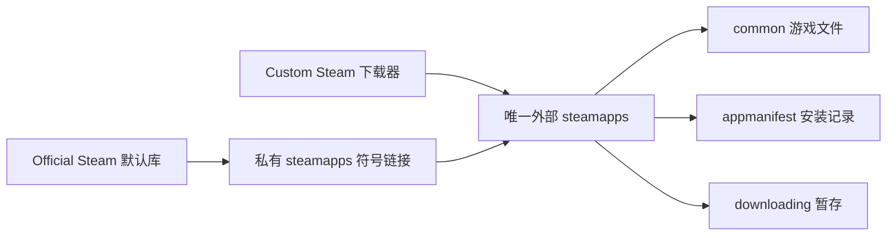

# Official / Custom Steam：同一游戏目录与存档

2026-10-17，`feature/linux_steam_support` 的共享库实现已随 `8c15fe11` 合入 `malos/main`。设备与 APK 验证见文末；未验证项不得视为完成。

**共享库阶段结果（v42）**：已保留数据安装 RelWithDebInfo APK。AYN 上 Official 大屏 → Hades II 标题 → 原大屏通过，JavaSteam 全程关闭；显式切回 Custom 后 JavaSteam 恢复，原 GBE 路线也进入同一游戏标题。共享 prefix 在真实 PRoot 映射内可见。52 项 Kotlin + 23 项 Python 测试通过。设备已关闭 phantom 子进程限制，否则 Steam + Wine 会被系统裁剪。该阶段官方 Cloud 仍关闭，未验证云同步往返、游戏内读档或长时间游玩；不能由标题画面推定这些通过。以下各 v25–v41 段落为保留的历史证据。

**后续退出与 Cloud（v43）**：已安装退出修复包，MHW 从标题菜单正常退出后自动返回官方大屏，并由官方客户端完成存档上传。用户授权以本机进度解决 MHW 冲突，存档已先备份；详见 [退出和云存档记录](steam-exit-cloud-20261017.md)。

## 用户要求与目录规则

用户要求停止键盘工作，优先处理游戏下载与存档共用；随后明确不要两套目录双向同步，目录使用 SteamPSP，并兼容旧 app 的 XRGameNative。

- 新库默认：`/sdcard/SteamPSP/Steam/steamapps`。
- 已有 `/sdcard/XRGameNative/Steam/steamapps` 时原地复用。不会因升级复制、搬迁或重新下载游戏，也不破坏旧 app 使用的路径。
- `.steampsp-library` 固定选定的根目录；卸载最后一个游戏后也不切到另一个根目录。
- 若两个根目录都已有游戏，停止自动接管并保留两边；不猜测覆盖或合并。
- Official 的私有 `home/Steam/steamapps` 是指向选定目录的符号链接。其默认库、ACF、`common`、`downloading` 都是同一份文件，Custom 直接使用该实体目录。不是两个游戏库之间复制文件。
- 首次接通前的私有空库元数据保留为 `steamapps.before-shared-directory`。若私有库已有游戏，拒绝直接替换，保留它等待显式整合。

## 安装记录与写入约束

Custom 已完成下载的 `.DepotDownloader/depot.config` 提供实际已安装 depot manifest ID，首次生成 ACF。使用精确的 64 位十进制值，不经浮点转换；缺少完成标记、存在进行中标记或 manifest 无效时不导出。原下载器没有记录 build ID，因此保留未知值 0，不拿服务器最新 build 冒充本地版本；官方可能在首次启动时验证/更新。

Official 写入的 ACF 成为同一目录的安装状态。Custom 查询它，应用数据库只是 UI 缓存；不为官方安装伪造 Custom 完成标记。下载中、正在更新、目录缺失或无效 ACF 不作为完整安装。私有索引记住曾接管的 app ID，防止官方卸载后被残留 `.download_complete` 重新识别；数据库中的云历史和 Wine 容器不随之删除。

Official 会话存续期间持有游戏库写入权。Custom 下载/校验/卸载须先回启动页切换到 Custom；只停止 Official 不自动恢复 JavaSteam。Custom 任务仍运行时也不能打开 Official。客户端进程结束后才释放写入权。此约束只保护这一个 app 的两种模式，无法禁止另一旧 app 同时修改同一目录。

## 存档与启动

游戏继续使用既有 `STEAM_<appId>` Wine 容器，不建立第二份 Proton prefix。Documents / AppData 保存目录保持原路径。Official `userdata/<account>/<appId>/remote` 指向该容器原有 Steam RemoteStorage 目录；所有账户标识仅在设备内部使用。

原目录已有相同内容时保留原副本后建立链接；若仅 Official 有文件，只向空目标做校验复制，再保留原副本；双方内容不同时拒绝覆盖，并阻止该游戏启动。单个游戏冲突不会阻止浏览整个官方客户端。

2026-10-17 后续用户要求**官方与非官方管理互斥**，当前实现改为：

| 职责 | Official Steam | Custom Steam（非官方） |
| --- | --- | --- |
| 登录、下载、更新、Workshop | Valve 官方 Linux 客户端 | 原 JavaSteam 管理链路 |
| 游戏内 Steam API | Proton `lsteamclient` → 官方 Bionic `libsteamclient` | 原捆绑 GBE 客户端 |
| 游戏会话、成就、云存档 | 官方客户端；兼容工具等待 Android 游戏退出 | 原 JavaSteam / GBE 流程 |
| 文件 | 同一 `steamapps`、同一现有 Wine prefix 与存档 | 同左 |

进入官方模式先保存管理归属、阻止 JavaSteam 自动启动/重连，再等待其 CM 连接关闭，之后才启动官方进程。切回 Custom 必须先结束游戏、等待官方子进程退出及库锁释放，之后恢复 JavaSteam。模式跨进程重启保留；Android 的游戏显示宿主 Activity 不代表进入 Custom 模式。

官方游戏由官方兼容工具发出请求；Android 仅接受当前有效请求对应的 AppID，不能从 Custom 界面偷偷换成官方游戏客户端。官方模式跳过 JavaSteam 的登录等待、Workshop 更新、Cloud launch/exit、GamesPlayed、踢会话和 GBE 成就回灌。公共安装记录/缓存的只读查询不启动 JavaSteam 网络连接。两套鉴权仍独立，未复制令牌；已有存档按账户校验。

官方 Play 使用独立的 `OfficialSteamGameActivity` 承载既有 Wine/XServer 运行界面，初始路由是游戏启动页，不先展示 Custom 游戏库。退出回 `LinuxSteamActivity`；Custom 的 Activity 和页面状态留在自己的导航栈中。

参考 DroidDeck 的 `steam-compatibility`（`use_sessions=1`、`compatmanager_layer_name=proton`），官方客户端负责会话和 Steam Cloud，兼容工具只维持游戏进程生命周期。`compatdata/<appid>/pfx` 指向原 `.wine`，`users/steamuser` 指向原 `users/xuser`，RemoteStorage 仍指向原 account/app 的 `remote`。这些链接存在内部文件系统，由 PRoot 将 link-only compatdata 绑定到外部游戏库路径，避免 FUSE 不支持 symlink；同时映射 Android 的 filesDir 及其 canonical 路径，使 `/data/user/0` 与 `/data/data` 下的链接都能解析到同一文件。已有独立非空 prefix 不覆盖、不隐藏。

早期 v25–v34 的“JavaSteam 负责两边云同步、强制关闭官方 Cloud”方案已废弃。新代码只迁移一次早期 `.steampsp-before-sharing` 备份中的 Cloud 偏好，不再每次启动强制改 Cloud 开关，后续尊重用户在官方 UI 的选择。旧 `cloud <appid>` 探针已移除：实际操作中发现 app-scoped SDK pipe 会令官方客户端登记 PID 0 并报“游戏已在运行”；新的会话检查不携带 AppID，旧 10/11 结果只保留在历史证据中。

存档别名、单一管理归属及模式切换仍须以下新版设备证据验证；不能把旧 v30 下载证据当作新云同步的验收。

## 验证状态

修改前的 AYN 库有 7 个已完成目录；Official 私有 steamapps 只有库列表和空 sourcemods，没有已安装游戏。修改前采集了既有容器用户目录/RemoteStorage 内 92 个文件的 SHA-256，保存在私有验证目录，不向公开仓库存入游戏文件、存档或账户信息。

- 初次候选的 Python handoff 3 项通过。
- 首次 Kotlin 定向测试 10 项中 9 项通过；失败指出首次写私有库索引前缺少父目录创建。修复后 v26 定向测试 39 项全部通过（共享库 14、IME 回归 10、X11 wire 8、语言 5、显示尺寸 2）。Python bootstrap/launcher/handoff 19 项通过。
- v25 APK SHA-256 `22333352a43fac74ec89b83d1063a722f27d660937e1439202674af2101c18a6` 已保留数据安装，RelWithDebInfo，audit 142/0。v26 `e64e0c51f70e4950672a562a5175883a707713fcbf12a3f7b0a0086876b86ca4` 已构建但未安装。
- AYN Thor，Android 13/API 33，fingerprint `qti/kalama/kalama:13/TKQ1.231222.001/eng.Thor.20260206.163241:user/release-keys`，boot `b509848d-21a5-4f1d-b6ed-24c0572aa9d2`。v25 App PID 1890、PRoot 2993、Xephyr 3017、Steam 3028、首个 CEF 3143；12:00–12:10 本地时间观察约 10 分钟。用户明确批准后确认了“另一端正在游戏”的提示。
- v25 共享目录两端 `stat` 的 device/inode 相同；Android 与独立 PRoot Python 均能读取 7 个 ACF。6 个有效旧容器已建立 RemoteStorage 链接；7 Billion Humans 只有空容器目录，因此尚不创建其存档链接。原 92 个用户/存档文件的 SHA-256 前后全部一致。
- **v25 尚未通过官方安装识别**：官方 content log 加载 0 apps，Storage 页面 0 items。不能以 Android 侧读到 ACF 代替官方识别通过。
- v25 停止客户端后 PRoot 已退出，但 libraryOwned 仍为 true，阻止重新打开。原因是取消后的协程在 Main cleanup 返回时再次抛出取消，跳过释放；候选将完整 cleanup 放入 NonCancellable，并仅在确认子进程结束后释放。设备复测待补。
- 最终 APK/component manifest/Build IDs、官方识别、反向安装状态读取、实际启动结果待补。原始日志、截图、存档哈希及失败记录保存在私有制品目录，不入公开仓库。

### v27：退出清理与云设置

APK `48ea3775f0335b3a74d8d3b688c22d82f1e1a504c4ef7d36ad5fdc8c1b07ccf9`，RelWithDebInfo，audit 142/0，40 项 Kotlin 定向测试与 19 项 Python 测试通过。Linux Steam manifest `1a86a01cf65bb8bdfaaac5a39e4c3600e4b40aadb2961fe53b41c3713efc4adf`，runtime catalog `c389df3e8db71bf054362b188abdb2ecdf92454649eb94b24af8451fd9598943`。

Build IDs：PRoot `a6b8f3798a5dc7c927a86f58a742e373dc21c6a0`，session probe `bdea20d90beca4512aa09fcdba2a114693c42a4c`，client compat `733a96b0683ef92c71d487cc8492ebdbc17efbf2`，winlator JNI `d57c4d4612088a6e48212ad7c177b3a8294079b5`。其余原生组件与 v25/v26 相同，完整表在私有 APK audit 中。

同一 AYN/boot，App PID 12354，首轮 PRoot 12714、Xephyr 12719、Steam 12725、CEF 12792。12:23–12:25 检查：Cloud 探针为 0；停止后确认子进程退出且 `libraryOwned=false`，同一 app 进程可再次打开；重开后 Cloud 探针仍为 0。这修复了 v25 的取消清理漏释放。

实际 app/PRoot 进程启动前探针读到 `manifests=7 readable=7`，但 Steam 仍记录 Loaded 0 apps。这排除了单纯的 adb/run-as 可见而 app 不可见；官方识别仍未通过，继续定位。

### 外部存储文件锁：根因与候选修复

v28 APK `6873ca46051b2cbd6037e9ea1ce252797730d76fa3f1d628e70724381795e34a` 尝试 PRoot 显式绑定私有 steamapps 别名，仍 Loaded 0 apps；已撤回这项无效改动。

v29 APK `6e18780b26b866ba554bfc70d61fbddcf2c13634d4820ef431c4b11eef296f21` 加入有界 opt-in 文件访问诊断。Steam 更新退出码 42 后重新启动，所以当前有效日志是 `client-1.log`，不能只读 `client-0.log`。同一 AYN/boot，App 17812、PRoot 18215、Steam 18226，12:36–12:38：7 个 ACF 和 libraryfolders 的 `open()` 全部成功，但随后的 `flock(..., LOCK_SH)` 均返回 `ENOSYS`（38）；Steam 将锁失败当作读取失败。

候选从 pinned DroidDeck 直接编译 `tools/linuxfs/preload/lock.c`，保留其 WinNative/GPL-3.0 归属，源文件不复制进主仓。仅客户端 glibc userspace 加载：先尝试真实 flock/fcntl，只有 ENOSYS/ENOTSUP/EOPNOTSUPP 才按文件系统不支持锁处理；F2FS 的真实锁、EAGAIN、EBADF、EACCES 保持原结果。这不是给 FUSE 实现了跨进程锁；Android 端的 Official/Custom 写入权限制仍必需，也不能保证另一旧 app 同时写入安全。

Linux 编译的同一 shim 已通过 6 项检查：真实同文件独占冲突及解锁，38/95 不支持降级，以及 11/9/13 错误不被吞掉。上机识别及下载验证待补。

### v30：官方识别与实际下载通过

APK `128d2c1421872000febbf7d7acb1f5416795c91754cd7a5d04da6c9dc05b633a`，RelWithDebInfo，audit 142/0。Linux Steam manifest `793b06eeb3f73e4e5c2fdcb4b36fcf16149876fa47d5ed147805db0a3d30e1e4`；client compat Build ID `7b62e40d621766b64ce706a5432e22009a0afb98`，其余组件/catalog 同 v27。AYN 同 boot，App PID 20456、PRoot 20853、Xephyr 20859、Steam 20865、CEF 20945。

12:43–12:49 本地时间：

- 官方日志由 Loaded 0 apps 变为 **Loaded 7 apps**，成功读取同目录的 libraryfolders.vdf。Big Picture 显示原有游戏；未复制原游戏。
- Steam 自动安装其公共运行库 app 228980：日志下载 167,392,992 bytes，校验后提交 174 个文件至默认库 `steamapps/common/Steamworks Shared`，4 个 depot、build 24098430，结果 No Error。通过符号链接，这就是旧 XRGameNative 外部实体目录；两端 device/inode 都是 `87:235861`。
- Android 侧随后读取同一官方 ACF，228980 从未完成变为 complete，4 个 depot。这验证了官方新增安装状态能被 Custom 侧读取，无反向文件复制。
- 官方将各游戏的共享 redist depot 转由 228980 管理；不把这个合法元数据变化当作游戏损坏。Alyx 标记 StateFlags=6（需更新），如实显示未完成，不用残留 Custom 标记冒充完全就绪。
- 原 92 个用户/存档文件的 SHA-256 再次全部相同。Cloud 探针为 0，6 个现有容器仍用原 RemoteStorage 目录。诊断 marker 已删除。

12:50 通过原 Custom 启动路径尝试 Balatro，未进入游戏：`LinuxSteamLauncher` 检查到 `legacycompat/steamclient.dll` 与首次下载的哈希不符。进一步核对发现官方更新器已替换这个自有目录中的两个 Steam DLL；失败发生在启动 Wine 之前。不能据此宣称游戏内读写或 Steam Play handoff 已通过。

候选把我们校验的 Windows ABI 缓存移到 app-private `linux-steam/windows-abi`，与 Steam 更新器拥有的 `home/Steam/legacycompat` 分开。缓存仍由 Valve HTTPS manifest/组件 SHA 校验产生；不直接接受被更新文件的新哈希。有效缓存直接复用，损坏缓存完整校验新包后替换；不认识的目录保留并报错。新增两项回归测试，Python 合计 21 项通过。设备已通过原下载器准备这个独立缓存，等待候选 APK 复测。

### v31：独立 ABI 缓存与重开

APK `add55d5ca7b3d26257bc3a408050251be8d36316248f8cf1e5f6f23a4f0e0057`，RelWithDebInfo，audit 142/0；Linux Steam manifest `990e969c6a76ff271ea393b9cc0671fdf917b89c62e75ea28dd143d3b99387a2`，原生 Build IDs 同 v30。40 项 Kotlin 定向测试、21 项 Python 测试通过。AYN 同 boot，App PID 4835、PRoot 5262、Xephyr 5268、Steam 5274、CEF 5356。

13:02–13:04 本地时间：重开官方记录 **Loaded 8 apps**（原 7 项加公共运行库），诊断 marker 关闭；独立 Windows ABI 校验通过，Balatro 启动已越过 DLL 校验和账户/Cloud 检查。原 Custom 云扫描仍找到原容器 AppData 中 4 个 `.jkr` 文件。

实际游戏仍未启动：命令中的 `/d "A:\"` 将结尾反斜杠解释为引号转义，`XrGameCommandLine.split` 报 Unclosed quote，进程未创建。候选为逐个参数加入配套编码（正确处理结尾反斜杠与字面引号），涵盖根目录、带空格子目录和 MHW 的目录别名，不更改游戏文件或运行目录语义。读到存档文件的云扫描不代表游戏内读档已通过。

启动尝试后的 92 文件复核：91 个原文件哈希保持相同；唯一变化是 Balatro 云同步流程重写的 `remotecache.vdf` 索引，四个 `.jkr` 存档内容没有变化。

### v32：参数编码通过，继续修复 Wine 启动入口

APK `f0f0704b92c94f2b78c530cd5aeb909b746b0d40a45b6f397ccb8dbd28397c29`，RelWithDebInfo，audit 142/0，44 项 Kotlin 定向测试通过（含 4 项命令行测试）。客户端 manifest 和原生组件同 v31。AYN 同 boot，App PID 8530、PRoot 8938、Xephyr 8944、Steam 8950、CEF 9026。

13:10 首次复测已创建 Wine PID 10319、wineserver 10352，约 12 秒后退出，游戏未执行。13:12 使用既有调试运行入口采集本地 Wine 日志，未提交任何报告：Wine 的 `start.exe` 把空标题参数作为空可执行名，随后退出码 1。源码 `references/proton-wine/programs/start/start.c` 提供 `/exec`，直接执行并等待程序，保留 `/d` 工作目录；候选改用这一入口。日志另报告缺少 libGL，Balatro 本身的 OpenGL 运行尚未验证；不能将它归因于共享目录。

### v33：Hades II 实际启动，发现双重会话上报

APK `8fce8e9dfbaa5c5174b588bf25eb74fdd46348321269e1ea40827cf22ce81731`，RelWithDebInfo，audit 142/0，44 项 Kotlin 与 21 项 Python 测试通过。客户端及原生组件同 v31。AYN 同 boot，App PID 12326、wineserver 14166、steam.exe 14360、Hades2.exe 14371；13:21–13:25 观察。

Hades II 从原 `A:\Ship\Hades2.exe` 启动并显示标题画面。Wine 日志 `SteamAPI_Init` 加载 Valve PE facade 成功；游戏进程 maps 同时包含 Bionic `lsteamclient.so` 和官方 `linux-steam/home/Steam/androidarm64/libsteamclient.so`，不是只做了客户端 pipe 探针。未进入存档场景。

JavaSteam 的 `notifyGamesPlayed` 也上报同一游戏，触发其 PlayingBlocked/LoggedInElsewhere 弹窗；在用户已有授权下确认继续后又出现，说明这不是应靠反复踢另一端解决的状态。已通过弹窗取消正常结束本轮游戏。

v34 中间候选（未安装，已被后续互斥模式方案替代）试图明确会话归属：官方模式不再由 JavaSteam 上报 GamesPlayed、踢 playing session、发出第二套 Cloud app-launch/app-exit 会话信号或回灌历史 GBE 成就；JavaSteam 保留实际存档下载/上传。其库连接收到另一游戏会话状态时，不再拿它关闭由官方客户端管理的本机游戏；官方自身的会话/账户限制仍由官方处理。

### v35 / v36：互斥模式与探针干扰

v35 APK `13ad2204dc1476d85b84ae0e0da92a7e27df93b2ec95729dd06ccc80fb670686`，RelWithDebInfo，142 项/0 错误。v36（未安装）包含退出后返回官方页面和旧 Service 清理隔离，APK `b45db0a2d5a5a9ad2594f303a654624c73011bcdafd54dc860351fa4fa610dff`。两者原生组件与 v30 相同，client manifest 同 v31。

AYN 同一 boot、app PID 26613：13:43 Custom 的 `javaRunning/javaConnected/javaLoggedIn` 均 true；13:44:30.861–.872 切入 Official 时 CM 主动断开，三者均 false。官方大屏显示游戏库，会话检查 0，5 个已完整安装且有 prefix 的游戏建立兼容路径（Alyx 下载未完成，不计入）。13:46 官方 Play 与旧 `cloud 1145350` 探针碰撞，官方 console 在同一秒记录 `ProcID 0`，随后 `WaitingPrevProcess` → `AppError_16`；没有 Wine 游戏进程，也没有 handoff 请求。旧探针不是无副作用的只读检查，已删除其 AppID/RemoteStorage 分支，不能据此归因于官方 Play 的执行失败。

同时官方 Cloud 日志暴露缺失 `getnativepath/getcompatpath` 兼容工具动词（WinSavedGames 无法解析），新版补充了共享 prefix 的 Windows/Unix 路径转换，不启动第二个 Wine server。原 92 文件先保存私有备份，未放入仓库。新版真实启动和 Cloud 路径验证待下文记录。

### v37：会话互斥通过，定位启动桥被误杀

APK `8cf1fdbed536b0e6ee55d370183397016d6eadcb3359831780c0c9f221b8dbe8`，RelWithDebInfo，audit 142/0。50 项 Kotlin 定向测试和 23 项 Python 测试全部通过。client manifest `222ad273606787b58fce697526ab5da14b03d6fe9fda106242cee70fd70077dc`；session probe Build ID `ba722107785de2182eaca5ae4611f552695b4d5c`，其余原生组件同 v30。

AYN 同 boot，app PID 32611。13:58–14:01 Official 登录、大屏浏览及 Play 时，JavaSteam 三个状态始终 false；新版无 AppID 的 session check 返回 0。真实 Play 已发出 handoff 并启动 Wine，但游戏没有起来：`ProcessHelper.listRunningWineProcesses` 原来在整个 cmdline 中搜索 `wine` 或 `exe`，把参数含 `Hades2.exe` 的官方 reaper/shell/Python 桥接进程（1840/1848/1850/1854）误判为旧 Wine，启动前直接杀掉。官方随后移除这些进程并结束游戏会话，Wine `steam.exe` 还留在等待中。通过应用退出按钮清理后返回官方页面，再停止官方，JavaSteam 仍不重连。

v38 改为按实际 argv[0]（Android linker 启动时为 argv[1]）识别 Wine/Windows 程序，覆盖启动前清理、暂停/恢复、退出以及进程快照，避免管理进程仅因参数带 `.exe` 而被干预。另以独立 Activity 隔离官方游戏页面，修复启动时露出 Custom 游戏库。

Cloud 的 Windows root 仍无法解析，说明仅补路径动词不够。参考 DroidDeck 的工具标识和 [Whisky 对兼容工具名的实测](https://github.com/frankea/Whisky/issues/228)，将注册标识由 `steampsp` 改为 `steampsp-proton-arm64`（目录不变），未修改 Valve 客户端二进制。v38 的官方 Cloud 日志已识别 Hades II / Balatro 的 Windows 文件，不再报告根目录无法解析；但设备的全局 Cloud 仍关闭，本轮不算实际 Cloud 同步验收。

### v38–v40：独立游戏页面与启动失败定位

v38 APK `a314d20deb3a227912b7cb97075d1eadbdc4ba64d3d3b5e764eb9a13ce6d9317`，RelWithDebInfo，audit 142/0；52 项 Kotlin 定向测试通过。客户端 manifest / native Build IDs 同 v37。AYN 同 boot，14:14–14:17：官方 Play 使用 `OfficialSteamGameActivity`，不再调起 Custom 的 MainActivity；官方 reaper / Python（11025 / 11026）在 Wine 启动后仍存活，误杀已消失。游戏未进入画面，通过快捷菜单退出返回官方页。

v39 进一步把模式选择放到 Service 主线程，避免异步启动反向覆盖 Custom 的选择；切回 Custom 时显式启动 JavaSteam。AYN app PID 14378，14:25–14:28 的定向 Wine 日志证明先前“helper 等待”只是表象：Hades2.exe 确实被创建，但 helper 报 `Failed to load lsteamclient module`，游戏随后以 `steam://run/1145350` 请求重启，转发失败。Custom prefix 清理了旧 Bionic `lsteamclient.dll`，官方入口仅部署 Valve facade 和 steam.exe，没有把配套 Proton PE bridge 放回 system32/syswow64。候选补充校验后的部署；不替换游戏目录 DLL，不启用 GBE。临时日志配置仅用于本轮定位。

v40（尚未安装，后续版本取代）APK `a2f7e3cf66fcaea0c8e532ff91dbe865219e411d6d7af1455a6fcbf69867dc04`，RelWithDebInfo，audit 142/0；52 项 Kotlin 测试通过。把 Cloud 迁移 marker/配置备份从官方 userdata 的 App 7 remote 目录移到应用内部迁移目录，避免 Steam 将这些内部文件上传为用户配置。迁移遇到不同内容保留两份并报错，已完成的迁移不会覆盖用户后来的 Cloud 设置。

### PRoot 存档路径可见性复核

14:31 同一 AYN 上以只读 PRoot Python 重放客户端的 bind 参数：`compatdata/1145350/pfx/drive_c/users/steamuser/Saved Games/Hades II/Profile1.sav` 不可见。其 canonical 目标是 `/data/data/<package>/files/...`，而此前仅 bind 了 `/data/user/0/<package>/files`；这两个名字在 Android 上相同，在 PRoot 内却不会自动成为同一路径。增加 canonical filesDir 的同路径 bind 后，同一探针读到原 Profile1.sav（21,022 bytes）。候选将这一绑定加入真实客户端构建参数；没有移动 prefix 或复制存档。本项只验证路径可读，不等于 Cloud 上传/下载已通过。

### v41：官方 Hades II 标题通过，发现 Android 子进程上限

APK `21f5bff26e99a4d505131e9719b471db9d9823077b0fc5df9f1c601e0eb01d78`，RelWithDebInfo，audit 142/0，client manifest / native Build IDs 同 v37。AYN app PID 20268，14:35–14:36：补齐 system32/syswow64 的配套 lsteamclient.dll 后，helper 的 `steamclient_init` 返回 0，Hades2.exe PID 21718 进入标题（截图 HUD 59.8 fps，仅瞬时值）。退出回官方 Activity，没有 Custom 首页。

本轮仍不能算稳定的官方会话：14:35:05.022 ActivityManager 明确以 `Trimming phantom processes` 杀死 PRoot PID 20697，Service 记录退出码 137，后续 Steam/CEF 一同退出。不是 JavaSteam 抢会话，也不是游戏崩溃。参考 DroidDeck `core/PhantomProcessLimit.kt` 及 README：Android 12+ 的子进程限制会终止 Steam + Wine 的多进程会话。当前 AYN（API 33）将 `settings_enable_monitor_phantom_procs` 从未设置调整为 `false`，原值保存在私有设备记录中；恢复命令是 `adb shell settings delete global settings_enable_monitor_phantom_procs`。这是设备级开发选项，影响所有 app 的此项子进程监管；并非关闭 lmkd 或内存回收。无 root、未修改其它设备。新设备部署需要检查这项条件，不能把本机设置当作 APK 自带能力。

### v42：官方模式回归

APK `0ac2bcf7c8359220e0d76161b0474838c144aff5f6734273ff93623fc0d3ac1e`，RelWithDebInfo，audit 142/0；52 项 Kotlin 定向测试及 23 项 Python 测试通过。client manifest / native Build IDs 同 v37，runtime catalog 同 v27。该版包含配套 PE bridge、canonical filesDir bind、按 Activity 归属过滤启动事件/销毁事件，以及官方错误返回路由。临时 Hades WINEDEBUG 已删除，仅删除本轮赋值，保留其余容器设置。

AYN 同 boot，app PID 23224、PRoot 23750、Steam 23761、wineserver 25165、steam.exe 25288、Hades2.exe 25299。14:41–14:43 从官方大屏实际 Play 进入 Hades II 标题；前台是 OfficialSteamGameActivity，游戏 maps 包含配套 lsteamclient.so 与 Valve androidarm64/libsteamclient.so。官方进程保持运行；javaRunning / javaConnected / javaLoggedIn 均 false。真实 PRoot cmdline 包含 canonical filesDir bind。未在本轮进入游戏存档场景；标题瞬时帧数不作为性能对照。

14:43:27 通过游戏快捷菜单退出后，官方记录 handoff 进程退出码 0，并从 running list 移除 1145350；返回原 LinuxSteamActivity（相同 Activity 记录），大屏恢复“开始游戏”。PRoot / Steam 没有重启，session check 为 0，JavaSteam 仍全 false。游戏 XServer / ActiveGameRegistry 均清空。本轮验证的游戏会话从 14:41:19 到 14:43:27，约 128 秒；不代表长时间游玩稳定性。

14:44 从启动页明确选择 Custom：等待官方停止后，mode=custom、running/display/libraryOwned 均 false；JavaSteam 的 running/connected/loggedIn 均 true，前台为 Custom MainActivity。没有靠再次登录或抢占另一端切换。官方游戏退出本身不启动 JavaSteam，只有用户选择 Custom 才恢复。

14:45–14:46 同一 APK 切回 Custom 后，Hades II 再次进入标题（wineserver 28622、GBE loader 28708、Hades2.exe 28735）。启动日志使用原 `steamclient_loader_x64.exe`，`PROTON_DISABLE_LSTEAMCLIENT=1`；游戏 maps 不含官方 Bionic libsteamclient，官方 PRoot 未运行，JavaSteam 三状态保持 true。两种入口使用相同 A:\Ship\Hades2.exe 与既有容器，没有第二份游戏树。该回归验证入口和运行时归属，不扩大为完整游戏/存档场景验收。

本轮结束后 Wine、游戏和官方 PRoot 已退出，ActiveGameRegistry / XServer 为空；临时输入已到期、临时 WINEDEBUG 已移除。设备保留 v42 APK 与上述已记录的子进程设置。
